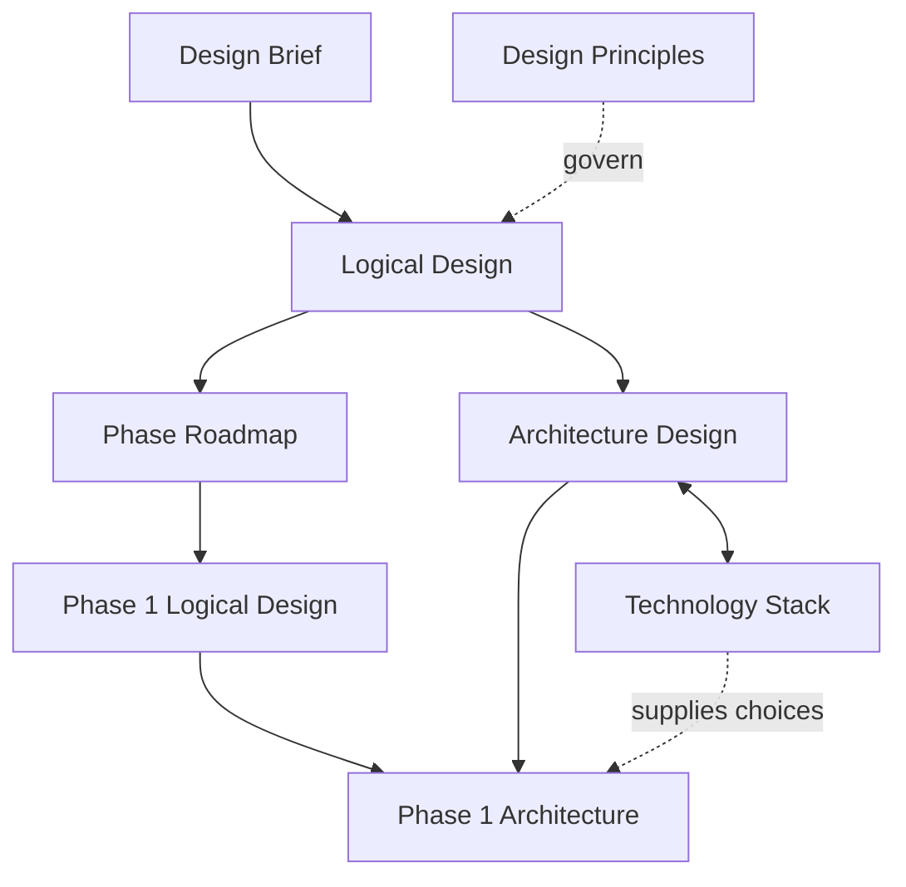

# msgloom Design Documents

Start with the complete product, then read the Phase 1 design. The English documents are authoritative; the Chinese documents are corresponding translations.

The implemented Scrapy project is named `message_ingest`. It is the message
acquisition component within this repository. See its
[component layout](component-layout.md) and [Outlook commands](outlook-commands.md).

## Document ownership

| Document | Scope | Owns |
| --- | --- | --- |
| [Design Brief](design-brief.md) | Complete product | Purpose, core concepts, final capabilities and report contract. |
| [Design Principles](design-principles.md) | All phases | Decision priorities and lasting constraints. |
| [Logical Design](design.md) | Complete product | Supporting concepts, data relationships and behaviour. |
| [Architecture Design](architecture.md) | Complete product | Component responsibilities, interfaces and end-to-end workflows. |
| [Technology Stack](tech-stack.md) | Complete product, with phase labels | Dependency choices, configuration, code quality and technical qualification. |
| [Phase Roadmap](phase-roadmap.md) | Delivery stages | Capability allocation and phase boundaries. |
| [Phase 1 Logical Design](phase-1/design.md) | Phase 1 only | Detailed rules and acceptance cases for the first release. |
| [Phase 1 Architecture](phase-1/architecture.md) | Phase 1 only | Deployment, execution sequences, storage writes and recovery. |
| [Microsoft Graph Live Acceptance](microsoft-live-acceptance.md) | Operator qualification | Read-only real-account smoke workflow and local acceptance evidence. |
| [A1 Microsoft Collection Closeout](notes/a1-closeout.md) | Phase 1 A1 | Closed source-capability matrix, fresh validation gates and the durable A1-to-A2 boundary. |
| [Teams T1/T2 Final Report](implementation/teams/final-report.md) | Phase 1 A1 Teams | Local acquisition acceptance, enterprise live limitations, and follow-up scope. |
| [A1 to A2 Handoff Contract](superpowers/specs/2026-10-03-a1-a2-handoff-contract-design.md) | Phase 1 A1/A2 boundary | Governing contract for integrated handoff code; implemented, exact-SHA qualified, and independently accepted. |
| [A1 to A2 Handoff Implementation Plan](superpowers/plans/2026-10-03-a1-a2-handoff-implementation-plan.md) | Phase 1 A1/A2 implementation | Governing task/DAG plan; Tasks 1–15 accepted. |
| [Task 15 Qualification Closeout](notes/task15-final-qualification-20261016.md) | Final qualification | Exact-SHA 28-gate results, evidence digests, independent review record, and attempt history. |
| [A2 Kedro-native Architecture Design](plans/2026-10-23-a2-kedro-native-design.md) | Planned A2 replacement | Kedro-primary end-to-end ETL design over frozen A1 handoff, trusted dataset adapters and async boundaries; independent review required. |
| [A1 to Kedro A2 Automatic Activation](notes/a1-kedro-handoff-activation-20261023.md) | A1/A2 integration proposal | Source-verified ReleaseEntry-to-Workset contract, Kedro Dataset mapping, external trigger and missed-event recovery. |
| [A1 Release to Kedro Automatic Handoff Plan](plans/2026-10-23-a1-release-to-kedro-auto-handoff.md) | A2 activation implementation plan | Prefect wake/catch-up, scoped retries, cold start and fourteen integration gates. |
| [A2 Kedro-native Implementation Plan](plans/2026-10-23-a2-kedro-native-implementation-plan.md) | Planned A2 replacement | Full A2 ETL DAG, security/bridge gates, bounded tasks, implementation deprecation and acceptance. |
| [Automatic A1 Release to Kedro A2](plans/2026-10-23-a1-release-to-kedro-auto-handoff.md) | A1→A2 automation design | Finite ledger/consumer-cursor intake, external Prefect wakeup and reconciliation, cold-start rules and failure tests. |
| [A2 Kedro ETL Decision](decisions/2026-10-23-a2-kedro-primary-etl.md) | A2 architecture authority | Reconfirmed user direction: Kedro main ETL, fresh A2, old A2 deprecated, accepted A1 handoff preserved. |
| [A2 Kedro Readiness Audit](notes/a2-kedro-readiness-audit-20261023.md) | A2 preparation assessment | Historical plan reconciliation, exact A1 source inventory and independent D4 review record. |
| [A2 Kedro First Independent Review](notes/a2-kedro-independent-review-r1-20261023.txt) | A2 planning review history | Original read-only REVISION verdict on 37f5886; retained without changing the result. |
| [A2 Kedro Second Independent Review](notes/a2-kedro-independent-review-r2-20261023.txt) | A2 planning review history | Second read-only REVISE verdict on c1ac6cf; precedes the major Kedro-primary design correction. |
| [A2 Kedro Third Independent Review](notes/a2-kedro-independent-review-r3-20261023.txt) | A1/A2 auto-handoff review | Read-only REVISE verdict on 3c0903b, with field, outcome and claim findings. |
| [A1 Kedro Handoff R3 Corrections](notes/a1-kedro-handoff-r3-corrections-20261023.md) | Proposed source-contract corrections | Field-level ReleasedInput mapping, distinct new A2 outcome statuses, claim scopes, deadline/identity and AUTO-15..22. |
| [Operator Configuration](notes/operator-configuration.md#scheduled-preparation) | Finite A2 operation | Stable scheduled intake targets, invocation format, explicit historical baseline service, pending-work retry, and recovery. |
| [Microsoft Graph Change Notifications](microsoft-change-notifications.md) | Deployment integration | Webhook validation/renewal boundary and privacy-safe sync-trigger contract. |

The integrated incremental handoff is documented in the
[Phase 1 collection/preparation boundary](phase-1/architecture.md#durable-incremental-handoff).
Runtime code is integrated. The official exact-SHA 28-gate run passed on
source `34057c6`, and the independent review accepted it; see the
[Task 15 closeout report](notes/task15-final-qualification-20261016.md).
Earlier scoped results remain in the
[historical qualification record](notes/a1-closeout.md#handoff-qualification-record--2026-10-07).
The closed A1 source-capability closeout is unchanged.

A definition belongs to its owner. Other documents use its exact term and link to it. Phase 1 adds restrictions and detail; it does not redefine the complete product.

Component names and step identifiers come from Architecture Design. Technology Stack maps those names to dependencies. Later-phase selections are proposals, not dependencies to install in Phase 1.

## Product progression

Read these as slices of one product, not four unrelated designs. The [Phase Roadmap](phase-roadmap.md) owns allocation; the linked logical contracts own behaviour.

| Phase | What the user gains | Boundary |
| --- | --- | --- |
| **1 — Reliable triage** | Preserved messages and attachments become grouped, prioritised topic reports through externally invoked commands. | No autonomous investigation or business actions. [Phase 1 design](phase-1/design.md) also reserves the extension interfaces. |
| **2 — Investigation and review** | Selected topics gain further evidence, related-topic links and visible uncertainty. The user navigates overview, details and sources through a local website; an optional MCP adapter uses the same operations. | Reads stay within permission and effort limits. Reports do not wait for unfinished investigation. See [investigation](design.md#6-investigation-and-review) and [report access](design.md#71-report-access-and-review). |
| **3 — Action support** | Topic assessments become suggested next steps and editable drafts for replies, tasks and tickets, with supporting evidence and unresolved questions. | Reviewing a draft does not authorise sending or creation in another system. See [proposal preparation](design.md#81-proposal-preparation). |
| **4 — Controlled execution** | The user can authorise an exact proposal for execution and inspect its recorded external outcome. | Permission, approval and freshness checks precede every submission; unknown effects require reconciliation. See [approval and execution](design.md#82-approval-and-execution). |

The complete-product [extension interfaces](architecture.md#8-extension-interfaces) are exercised with test doubles in Phase 1. Later implementations replace those doubles without adding business logic to the CLI, website or MCP transport.
